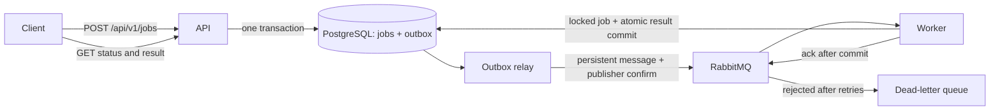

# Distributed Job Processing Platform

An asynchronous job service built with **Java 21, Spring Boot, PostgreSQL, and RabbitMQ**. Submit a job over HTTP, process it in a separate worker, and retrieve its status and result.

## Features

- REST endpoints for job submission, retrieval, and paginated status filtering.
- Persistent scheduling with `scheduledAt` and job priorities from 0 to 9.
- Queued-job cancellation and idempotent retries linked to the original job.
- Paginated, persisted job history with atomic status and audit updates.
- Text handlers for word counting, SHA-256 hashing, and uppercase conversion.
- PostgreSQL persistence with versioned Flyway migrations.
- Transactional outbox and confirmed RabbitMQ publishing.
- Idempotent request submission and duplicate delivery handling.
- Bounded infrastructure retries and a dead-letter queue.
- Independent API and worker containers, with configurable worker concurrency.
- Health checks, Prometheus metrics, automated tests, and GitHub Actions CI.

## Run locally

Install Docker with the Compose plugin, then run:

```sh
docker compose up --build -d
curl http://localhost:8080/actuator/health
```

The first build downloads the Java dependencies. PostgreSQL and RabbitMQ must pass their health checks before the application starts.

Submit a job:

```sh
curl -i -X POST http://localhost:8080/api/v1/jobs \
  -H 'Content-Type: application/json' \
  -H 'Idempotency-Key: example-word-count-1' \
  -d '{"type":"WORD_COUNT","text":"hello distributed job platform"}'
```

The response is `202 Accepted` with a job ID and a `Location` header. Read the result using that ID:

```sh
curl http://localhost:8080/api/v1/jobs/JOB_ID
```

Once processed, the response includes:

```json
{
  "status": "SUCCEEDED",
  "result": {"wordCount": 4, "characterCount": 30}
}
```

This example shows the result fields; the full response also includes the ID, type, original text, error, timestamps, and `retryOf` (null for an ordinary submission). Jobs move from `QUEUED` to `SUCCEEDED`, `FAILED`, or `CANCELLED`. The handlers perform short local computations; the result, terminal status, and corresponding history event commit in one transaction.

## API

| Method | Endpoint | Behavior |
| --- | --- | --- |
| POST | `/api/v1/jobs` | Accept a JSON body with `type` and `text` |
| GET | `/api/v1/jobs/{id}` | Read a persisted job and its result |
| GET | `/api/v1/jobs?status=SUCCEEDED&page=0&size=20` | List jobs, newest first |
| POST | `/api/v1/jobs/{id}/cancel` | Cancel a queued job; repeating cancellation is safe |
| POST | `/api/v1/jobs/{id}/retry` | Create a linked retry of a failed or cancelled job |
| GET | `/api/v1/jobs/{id}/events?page=0&size=20` | Read persisted history, oldest first |
| GET | `/actuator/health` | Check service health |
| GET | `/actuator/prometheus` | Read Prometheus metrics |

List responses contain `items`, `page`, `size`, and `hasNext`. Page size is limited to 100. `text` must be nonblank and at most 16,000 UTF-16 code units. Unknown properties, invalid types, and malformed identifiers return `400`; missing jobs return `404`. Errors use Spring's problem detail responses.

| Job type | Result | Definition |
| --- | --- | --- |
| `WORD_COUNT` | `wordCount`, `characterCount` | Unicode whitespace separates words; characters are Unicode code points |
| `SHA256` | `sha256` | Lowercase hexadecimal SHA-256 digest of the exact UTF-8 input |
| `UPPERCASE` | `text` | Locale-independent Unicode uppercase conversion |

An optional `Idempotency-Key` header accepts 1-128 characters from `A-Z`, `a-z`, `0-9`, `.`, `_`, `:`, and `-`. Repeating the same key and body returns the existing job with `200 OK`. Reusing a key for different input returns `409 Conflict`. Keys are global to this service and remain reserved while their job exists. Without a key, each request creates a new job.

## Scheduling and priorities

Use the optional `scheduledAt` and `priority` fields when submitting a job:

```json
{
  "type": "SHA256",
  "text": "process this later",
  "priority": 8,
  "scheduledAt": "2030-06-01T12:00:00Z"
}
```

`scheduledAt` accepts an ISO-8601 timestamp with a UTC offset, between years 0001 and 9999. Timestamps are stored at microsecond precision. Omitting it makes a job immediately eligible; past timestamps are also immediately eligible. Future jobs remain durably queued in PostgreSQL and are published once due. The dispatcher polls once per second, so execution can start later than the requested time.

Priority defaults to `0`; `9` is highest. The relay selects due jobs by descending priority, and RabbitMQ's priority queue also prioritizes messages waiting for delivery. Priority does not interrupt work already running or reorder messages already prefetched by a worker. Multiple consumers do not provide a strict global completion order, and a continuous stream of high-priority jobs can delay lower-priority work.

Responses include both fields. Idempotency checks include priority and the normalized schedule, so changing either while reusing a key returns `409`.

## Cancellation, retry, and history

Cancel a queued or scheduled job with an empty-body request:

```sh
curl -X POST http://localhost:8080/api/v1/jobs/JOB_ID/cancel
```

Cancellation returns `200 OK` with `CANCELLED` and a completion timestamp, removes any remaining outbox entry, and records a history event. Messages already in RabbitMQ may still be delivered; workers skip the cancelled job. Repeating cancellation returns the same job without recording another transition.

The API and worker serialize on the same job-row lock. Cancellation can prevent execution if it obtains the lock first. A worker that already owns the lock finishes its bounded computation first; cancellation then returns `409` for the completed job. This endpoint does not interrupt a running handler.

Retry a `FAILED` or `CANCELLED` job using a **new, required** idempotency key:

```sh
curl -i -X POST http://localhost:8080/api/v1/jobs/JOB_ID/retry \
  -H 'Idempotency-Key: retry-example-1'
```

A retry returns `202 Accepted` with a new ID and `Location` header. It inherits the original type, text, and priority, sets `retryOf` to the original ID, and is immediately eligible (`scheduledAt` is null). The original status, result, error, and schedule remain intact. Repeating that retry request with the same key returns the same child job with `200 OK`, even after the child finishes. A different key deliberately creates another retry; using a key belonging to a different source or ordinary submission returns `409`.

Linked retries prevent a delayed message for an old job from triggering a new run. Only failed or cancelled jobs can be retried; queued and successful jobs return `409`. Both control endpoints accept no request body and return `400` for unexpected JSON bodies. Missing IDs return `404`.

Read a job's history:

```sh
curl 'http://localhost:8080/api/v1/jobs/JOB_ID/events?page=0&size=20'
```

History responses use the same `items`, `page`, `size`, and `hasNext` envelope as job lists. Each event contains an opaque increasing `id`, `jobId`, `type`, `status`, `relatedJobId`, and `occurredAt`. Events are ordered oldest first; IDs can contain gaps. Submission, terminal transitions, and retry requests are recorded transactionally. A retry adds a `RETRY_REQUESTED` event to its source with the new ID, and a `SUBMITTED` event to its child with the source ID.

History describes committed lifecycle changes. It does not count infrastructure delivery attempts whose transactions roll back. Existing jobs receive a `BASELINE` event when this migration is applied, representing their known state at upgrade time; earlier events are not reconstructed.

## Architecture and delivery behavior



Job creation and the outbox entry commit together. The relay locks a batch using `FOR UPDATE SKIP LOCKED` and removes entries only after RabbitMQ confirms delivery without an unroutable return. A broker failure leaves entries in PostgreSQL for a later attempt.

Delivery is **at least once**: a crash between broker confirmation and outbox deletion can publish the same job again. Workers lock the job row and skip terminal jobs, so concurrent duplicate messages do not recompute a committed result. Handler execution and result persistence share a database transaction. This design supports the included bounded, side-effect-free handlers; an external side effect would need its own idempotency strategy.

Handler exceptions produce a persisted `FAILED` job with a sanitized error. Database and infrastructure exceptions roll back the worker transaction and trigger up to three delivery attempts with 500 ms and 1 s backoff. Exhausted messages go to `jobs.dead`; their jobs remain `QUEUED`. After resolving the infrastructure problem, an operator can cancel that job and use the retry endpoint to create a linked replacement. Republishing a stale message for the cancelled source is harmless. Operators can also republish the original UUID while its job remains queued. Dead-letter messages can be inspected in RabbitMQ's management console.

The included Compose setup uses one PostgreSQL instance and one RabbitMQ node with persistent local volumes. Exposed ports bind to localhost. The HTTP API has no authentication and is intended for local development.

## Tests

The suite contains **55 unit tests and 40 integration tests**. CI also builds the image and runs the packaged lifecycle smoke check.

Run the unit and integration suite with Docker:

```sh
./scripts/test.sh
```

Tests use separate PostgreSQL and RabbitMQ containers. The `jobs_test` database uses ephemeral storage. Table cleanup refuses to run against a database whose name does not end in `_test`. The suite covers handler correctness, request validation, concurrent idempotency, duplicate delivery, transaction rollback on publishing failure, concurrent outbox relays, scheduling deadlines, broker priority ordering, legacy queue compatibility, SQL-like input, the full HTTP-to-worker pipeline, and dead-letter routing and recovery.

Lifecycle coverage includes concurrent cancellation and retry requests, cancellation racing with worker completion, stale-message handling, persisted history and pagination, rollback when audit writes fail, and upgrades that preserve earlier jobs and results.

With the packaged application running, check the complete control workflow with Python 3:

```sh
python3 scripts/smoke.py
```

This creates two inspectable jobs: a cancelled scheduled job and its successful immediate retry. It verifies replay behavior, worker output, history pagination, and conflict responses. Use `--base-url` to select a different application address.

With Java 21+ installed, unit tests can also run without service containers:

```sh
./mvnw test
```

For integration tests outside Docker, set `SPRING_DATASOURCE_URL`, `SPRING_DATASOURCE_USERNAME`, `SPRING_DATASOURCE_PASSWORD`, and `SPRING_RABBITMQ_*` to dedicated test services, then run `./mvnw verify -Pintegration`. The configured database name must end in `_test`; its job tables are cleared by the suite. Use a separate RabbitMQ instance as well: tests consume, purge, and republish messages in its job queues.

## Operations

To upgrade an existing checkout, stop application containers before rebuilding. Flyway applies the new database migration automatically and retains existing jobs. The worker continues consuming the original `jobs.ready` queue alongside `jobs.priority.ready`, so previously queued messages can drain without deleting queues or volumes.

```sh
docker compose stop api worker
docker compose up --build -d
```

```sh
# Run three worker containers against the same queue.
docker compose up -d --scale worker=3

# Read API and worker logs.
docker compose logs -f api worker

# Stop services, retaining application data volumes.
docker compose down
```

Worker concurrency defaults to two consumers per instance and can be set with `WORKER_CONCURRENCY`. The API dispatches outbox batches every second. The management console is at [localhost:15672](http://localhost:15672), with local credentials `jobs` / `jobs-local`. Port and credential overrides are documented in `.env.example`.

## References

Implementation references: [Spring's RabbitMQ guide and sample repository](https://github.com/spring-guides/gs-messaging-rabbitmq), [Spring AMQP documentation](https://docs.spring.io/spring-amqp/reference/), and [RabbitMQ acknowledgements and publisher confirms](https://www.rabbitmq.com/docs/confirms).

## License

[MIT](LICENSE)
