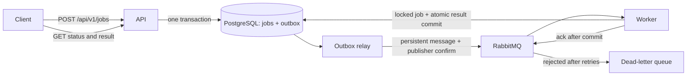

# Distributed Job Processing Platform

An asynchronous job service built with **Java 21, Spring Boot, PostgreSQL, and RabbitMQ**. Submit a job over HTTP, process it in a separate worker, and retrieve its status and result.

## Features

- REST endpoints for job submission, retrieval, and paginated status filtering.
- Text handlers for word counting, SHA-256 hashing, and uppercase conversion.
- PostgreSQL persistence with versioned Flyway migrations.
- Transactional outbox and confirmed RabbitMQ publishing.
- Idempotent request submission and duplicate delivery handling.
- Bounded infrastructure retries and a dead-letter queue.
- Independent API and worker containers, with configurable worker concurrency.
- Health checks, Prometheus metrics, automated tests, and GitHub Actions CI.

## Run locally

Install Docker with the Compose plugin, then run:

```sh
docker compose up --build -d
curl http://localhost:8080/actuator/health
```

The first build downloads the Java dependencies. PostgreSQL and RabbitMQ must pass their health checks before the application starts.

Submit a job:

```sh
curl -i -X POST http://localhost:8080/api/v1/jobs \
  -H 'Content-Type: application/json' \
  -H 'Idempotency-Key: example-word-count-1' \
  -d '{"type":"WORD_COUNT","text":"hello distributed job platform"}'
```

The response is `202 Accepted` with a job ID and a `Location` header. Read the result using that ID:

```sh
curl http://localhost:8080/api/v1/jobs/JOB_ID
```

Once processed, the response includes:

```json
{
  "status": "SUCCEEDED",
  "result": {"wordCount": 4, "characterCount": 30}
}
```

This example shows the result fields; the full response also includes the ID, type, original text, error, and timestamps. Jobs move from `QUEUED` to `SUCCEEDED` or `FAILED`. The handlers perform short local computations, and the result and terminal status commit in one transaction.

## API

| Method | Endpoint | Behavior |
| --- | --- | --- |
| POST | `/api/v1/jobs` | Accept a JSON body with `type` and `text` |
| GET | `/api/v1/jobs/{id}` | Read a persisted job and its result |
| GET | `/api/v1/jobs?status=SUCCEEDED&page=0&size=20` | List jobs, newest first |
| GET | `/actuator/health` | Check service health |
| GET | `/actuator/prometheus` | Read Prometheus metrics |

List responses contain `items`, `page`, `size`, and `hasNext`. Page size is limited to 100. `text` must be nonblank and at most 16,000 UTF-16 code units. Unknown properties, invalid types, and malformed identifiers return `400`; missing jobs return `404`. Errors use Spring's problem detail responses.

| Job type | Result | Definition |
| --- | --- | --- |
| `WORD_COUNT` | `wordCount`, `characterCount` | Unicode whitespace separates words; characters are Unicode code points |
| `SHA256` | `sha256` | Lowercase hexadecimal SHA-256 digest of the exact UTF-8 input |
| `UPPERCASE` | `text` | Locale-independent Unicode uppercase conversion |

An optional `Idempotency-Key` header accepts 1-128 characters from `A-Z`, `a-z`, `0-9`, `.`, `_`, `:`, and `-`. Repeating the same key and body returns the existing job with `200 OK`. Reusing a key for different input returns `409 Conflict`. Keys are global to this service and remain reserved while their job exists. Without a key, each request creates a new job.

## Architecture and delivery behavior



Job creation and the outbox entry commit together. The relay locks a batch using `FOR UPDATE SKIP LOCKED` and removes entries only after RabbitMQ confirms delivery without an unroutable return. A broker failure leaves entries in PostgreSQL for a later attempt.

Delivery is **at least once**: a crash between broker confirmation and outbox deletion can publish the same job again. Workers lock the job row and skip terminal jobs, so concurrent duplicate messages do not recompute a committed result. Handler execution and result persistence share a database transaction. This design supports the included bounded, side-effect-free handlers; an external side effect would need its own idempotency strategy.

Handler exceptions produce a persisted `FAILED` job with a sanitized error. Database and infrastructure exceptions roll back the worker transaction and trigger up to three delivery attempts with 500 ms and 1 s backoff. Exhausted messages go to `jobs.dead`; their jobs remain `QUEUED` until an operator resolves the problem and republishes their UUIDs. Dead-letter messages can be inspected in RabbitMQ's management console.

The included Compose setup uses one PostgreSQL instance and one RabbitMQ node with persistent local volumes. Exposed ports bind to localhost. The HTTP API has no authentication and is intended for local development.

## Tests

Run the unit and integration suite with Docker:

```sh
./scripts/test.sh
```

Tests use separate PostgreSQL and RabbitMQ containers. The test database uses ephemeral storage and does not touch the application's database. The suite covers handler correctness, request validation, concurrent idempotency, duplicate delivery, transaction rollback on publishing failure, SQL-like input, the full HTTP-to-worker pipeline, and dead-letter routing.

With Java 21+ installed, unit tests can also run without service containers:

```sh
./mvnw test
```

For integration tests outside Docker, set `SPRING_DATASOURCE_URL`, `SPRING_DATASOURCE_USERNAME`, `SPRING_DATASOURCE_PASSWORD`, and `SPRING_RABBITMQ_*` to dedicated test services, then run `./mvnw verify -Pintegration`. Integration tests clear their configured database's job tables.

## Operations

```sh
# Run three worker containers against the same queue.
docker compose up -d --scale worker=3

# Read API and worker logs.
docker compose logs -f api worker

# Stop services, retaining application data volumes.
docker compose down
```

Worker concurrency defaults to two consumers per instance and can be set with `WORKER_CONCURRENCY`. The API dispatches outbox batches every second. The management console is at [localhost:15672](http://localhost:15672), with local credentials `jobs` / `jobs-local`. Port and credential overrides are documented in `.env.example`.

## References

Implementation references: [Spring's RabbitMQ guide and sample repository](https://github.com/spring-guides/gs-messaging-rabbitmq), [Spring AMQP documentation](https://docs.spring.io/spring-amqp/reference/), and [RabbitMQ acknowledgements and publisher confirms](https://www.rabbitmq.com/docs/confirms).

## License

[MIT](LICENSE)
