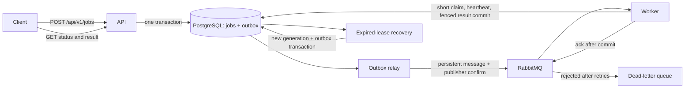

# Distributed Job Processing Platform

An asynchronous job service built with **Java 21, Spring Boot, PostgreSQL, and RabbitMQ**. Submit a job over HTTP, process it in a separate worker, and retrieve its status and result.

## Features

- REST endpoints for job submission, retrieval, and paginated status filtering.
- Persistent scheduling with `scheduledAt` and job priorities from 0 to 9.
- Queued and cooperative running-job cancellation, plus linked idempotent manual retries.
- Visible running state, durable execution attempts, renewable worker leases, and crash recovery.
- Fixed execution deadlines and generation-fenced message delivery and result writes.
- Per-job attempt limits, durable exponential backoff, and classified automatic retries.
- Persistent dead-letter inspection with bounded broker collection and audited, idempotent recovery/discard.
- Paginated, persisted job history with atomic status and audit updates.
- Text handlers for word counting, SHA-256 hashing, and uppercase conversion.
- PostgreSQL persistence with versioned Flyway migrations.
- Transactional outbox and confirmed RabbitMQ publishing.
- Idempotent request submission and duplicate delivery handling.
- Bounded infrastructure retries and a dead-letter queue.
- Independent API and worker containers, with configurable worker concurrency.
- Health checks, Prometheus metrics, automated tests, and GitHub Actions CI.

## Run locally

Install Docker with the Compose plugin, then run:

```sh
docker compose up --build -d
curl http://localhost:8080/actuator/health
```

The first build downloads the Java dependencies. PostgreSQL and RabbitMQ must pass their health checks before the application starts.

Submit a job:

```sh
curl -i -X POST http://localhost:8080/api/v1/jobs \
  -H 'Content-Type: application/json' \
  -H 'Idempotency-Key: example-word-count-1' \
  -d '{"type":"WORD_COUNT","text":"hello distributed job platform"}'
```

The response is `202 Accepted` with a job ID and a `Location` header. Read the result using that ID:

```sh
curl http://localhost:8080/api/v1/jobs/JOB_ID
```

Once processed, the response includes:

```json
{
  "status": "SUCCEEDED",
  "result": {"wordCount": 4, "characterCount": 30}
}
```

This example shows the result fields; the full response also includes the ID, type, original text, error, timestamps, and `retryOf` (null for an ordinary submission). Jobs move from `QUEUED` to `RUNNING`, then `SUCCEEDED`, `FAILED`, or `CANCELLED`; queued jobs can also be cancelled before execution. Responses include `timeoutSeconds`, `attemptCount`, `activeAttemptId`, and `deadlineAt`. Claiming and finalizing use separate short transactions; the handler runs between them without a database connection or row lock. The final result, terminal status, attempt outcome, and corresponding history event commit together.

## API

| Method | Endpoint | Behavior |
| --- | --- | --- |
| POST | `/api/v1/jobs` | Accept a JSON body with `type` and `text` |
| GET | `/api/v1/jobs/{id}` | Read a persisted job and its result |
| GET | `/api/v1/jobs?status=SUCCEEDED&page=0&size=20` | List jobs, newest first |
| POST | `/api/v1/jobs/{id}/cancel` | Cancel a queued or running job; repeating cancellation is safe |
| POST | `/api/v1/jobs/{id}/retry` | Create a linked retry of a failed or cancelled job |
| GET | `/api/v1/jobs/{id}/events?page=0&size=20` | Read persisted history, oldest first |
| GET | `/api/v1/jobs/{id}/attempts?page=0&size=20` | Read execution attempts, oldest first |
| GET | `/api/v1/dead-letters?state=OPEN&page=0&size=20` | Inspect the persistent dead-letter inbox, oldest first |
| GET | `/api/v1/dead-letters/{id}` | Inspect a sanitized dead-letter record and its resolution |
| POST | `/api/v1/dead-letters/collect?limit=20` | Archive at most 1–100 messages from `jobs.dead` |
| POST | `/api/v1/dead-letters/{id}/recover` | Deliberately recover valid work; requires an idempotency key |
| POST | `/api/v1/dead-letters/{id}/discard` | Resolve an inbox entry without scheduling work; requires an idempotency key |
| GET | `/actuator/health` | Check service health |
| GET | `/actuator/prometheus` | Read Prometheus metrics |

List responses contain `items`, `page`, `size`, and `hasNext`. Page size is limited to 100. `text` must be nonblank and at most 16,000 UTF-16 code units. Unknown properties, invalid types, and malformed identifiers return `400`; missing jobs return `404`. Errors use Spring's problem detail responses.

| Job type | Result | Definition |
| --- | --- | --- |
| `WORD_COUNT` | `wordCount`, `characterCount` | Unicode whitespace separates words; characters are Unicode code points |
| `SHA256` | `sha256` | Lowercase hexadecimal SHA-256 digest of the exact UTF-8 input |
| `UPPERCASE` | `text` | Locale-independent Unicode uppercase conversion |

An optional `Idempotency-Key` header accepts 1-128 characters from `A-Z`, `a-z`, `0-9`, `.`, `_`, `:`, and `-`. Repeating the same key and body returns the existing job with `200 OK`. Reusing a key for different input returns `409 Conflict`. Keys are global to this service and remain reserved while their job exists. Without a key, each request creates a new job.

## Scheduling and priorities

Use the optional `scheduledAt` and `priority` fields when submitting a job:

```json
{
  "type": "SHA256",
  "text": "process this later",
  "priority": 8,
  "scheduledAt": "2030-06-01T12:00:00Z"
}
```

`scheduledAt` accepts an ISO-8601 timestamp with a UTC offset, between years 0001 and 9999. Timestamps are stored at microsecond precision. Omitting it makes a job immediately eligible; past timestamps are also immediately eligible. Future jobs remain durably queued in PostgreSQL and are published once due. The dispatcher polls once per second, so execution can start later than the requested time.

Priority defaults to `0`; `9` is highest. The relay selects due jobs by descending priority, and RabbitMQ's priority queue also prioritizes messages waiting for delivery. Priority does not interrupt work already running or reorder messages already prefetched by a worker. Multiple consumers do not provide a strict global completion order, and a continuous stream of high-priority jobs can delay lower-priority work.

Responses include both fields. Idempotency checks include priority and the normalized schedule, so changing either while reusing a key returns `409`.

## Cancellation, retry, and history

Cancel a queued, scheduled, or running job with an empty-body request:

```sh
curl -X POST http://localhost:8080/api/v1/jobs/JOB_ID/cancel
```

Cancellation returns `200 OK` with `CANCELLED` and a completion timestamp, removes any remaining outbox entry, and records a history event. Messages already in RabbitMQ may still be delivered; workers skip the cancelled job. Repeating cancellation returns the same job without recording another transition.

Cancellation fences a running attempt in a short transaction and returns without waiting for its handler. The worker learns of cancellation at its next heartbeat, and cooperative handlers stop at a checkpoint. Results arriving after cancellation are rejected. If successful or failed completion commits first, cancellation returns `409`. Arbitrary Java code cannot be forcibly stopped safely: a custom handler that ignores checkpoints may continue computing or performing side effects, although it can no longer commit a job result. Such handlers need their own cancellation and side-effect idempotency strategy.

Retry a `FAILED` or `CANCELLED` job using a **new, required** idempotency key:

```sh
curl -i -X POST http://localhost:8080/api/v1/jobs/JOB_ID/retry \
  -H 'Idempotency-Key: retry-example-1'
```

A retry returns `202 Accepted` with a new ID and `Location` header. It inherits the original type, text, priority, timeout, and retry policy, sets `retryOf` to the original ID, and is immediately eligible (`scheduledAt` is null). The original status, result, error, and schedule remain intact. Repeating that retry request with the same key returns the same child job with `200 OK`, even after the child finishes. A different key deliberately creates another retry; using a key belonging to a different source or ordinary submission returns `409`.

Linked retries prevent a delayed message for an old job from triggering a new run. Only failed or cancelled jobs can be retried; queued, running, and successful jobs return `409`. A manual retry starts a fresh execution budget and attempt history under its new job ID. Both control endpoints accept no request body and return `400` for unexpected JSON bodies. Missing IDs return `404`.

Read a job's history:

```sh
curl 'http://localhost:8080/api/v1/jobs/JOB_ID/events?page=0&size=20'
```

History responses use the same `items`, `page`, `size`, and `hasNext` envelope as job lists. Each event contains an opaque increasing `id`, `jobId`, `type`, `status`, `relatedJobId`, `attemptId`, and `occurredAt`. Events are ordered oldest first; IDs can contain gaps. Submission, attempt starts, terminal transitions, lease expiry, recovery exhaustion, and retry requests are recorded transactionally. A retry adds a `RETRY_REQUESTED` event to its source with the new ID, and a `SUBMITTED` event to its child with the source ID.

History describes committed lifecycle changes. It does not count infrastructure delivery attempts whose transactions roll back. Existing jobs receive a `BASELINE` event when this migration is applied, representing their known state at upgrade time; earlier events are not reconstructed.

## Execution attempts and recovery

Set an optional execution budget when submitting a job:

```json
{
  "type": "WORD_COUNT",
  "text": "a bounded unit of work",
  "timeoutSeconds": 30
}
```

`timeoutSeconds` accepts an integer from 1 to 3600 and defaults to the configured value, initially 30. The effective timeout participates in idempotency checks; explicitly send it when replaying requests across configuration changes. The budget starts at the first committed execution claim; initial queue and scheduling wait do not consume it. Once started, the deadline stays fixed across worker recovery, including time waiting for replacement delivery. A manual linked retry receives a fresh budget under its new job ID.

A worker commits `RUNNING`, an attempt record, and a `STARTED` history event before computing. Heartbeats renew the attempt's lease without extending its deadline. The default lease is 15 seconds and the default heartbeat interval is 2 seconds. Worker identity is generated once per application process. Claim tokens are internal and never returned by the API.

The API's recovery scheduler scans expired executions every second. It marks a lost attempt `ABANDONED`, advances the delivery generation, and requeues the job through the transactional outbox. Multiple schedulers use row locks with `SKIP LOCKED`; they cannot recover the same attempt twice. An expired lease cannot be renewed, and an old claim cannot update or finish a replacement attempt. Recovery is bounded to three worker-loss recoveries by default and also respects the job's total attempt cap. Exhaustion produces a failed job and a persistent dead-letter record. Handler-failure retries use the separate classification and backoff rules below.

Deadline expiry produces job status `FAILED` with `Execution deadline exceeded` and attempt outcome `TIMED_OUT`. The heartbeat, result-write guard, and recovery scan enforce expiry. A recovered queued job can time out before replacement delivery. The next scan can run later than the exact deadline, but a result written after expiry is rejected. If the database is unavailable, durable transitions wait for it to recover; the worker never treats an unconfirmed heartbeat as a lease renewal.

Read attempt history with:

```sh
curl 'http://localhost:8080/api/v1/jobs/JOB_ID/attempts?page=0&size=20'
```

The paginated response includes each attempt's ID, number, generation, worker ID, status, start, last heartbeat, lease expiry, execution deadline, finish time, and sanitized error. Attempt outcomes are `RUNNING`, `SUCCEEDED`, `FAILED`, `CANCELLED`, `TIMED_OUT`, or `ABANDONED`. Attempts are recorded from this upgrade onward; completed legacy jobs retain their existing results without invented attempt records.

Custom handlers should use `ExecutionControl.checkpoint()` between bounded units of work, or `ExecutionControl.pause(...)` for cooperative waiting. Included handlers check before and after their bounded text computation. Logical cancellation and stale-result rejection are durable; stopping arbitrary non-cooperative code or undoing an external side effect is not guaranteed. If custom code ignores cancellation and blocks a worker, restart that worker process.

| Setting | Default | Purpose |
| --- | --- | --- |
| `JOB_TIMEOUT_SECONDS` | 30 | Default execution budget, 1–3600 seconds |
| `JOB_LEASE_SECONDS` | 15 | Renewable execution lease, 3–300 seconds |
| `JOB_HEARTBEAT_MILLIS` | 2000 | Renewal interval; at most one third of the lease |
| `JOB_MAX_RECOVERIES` | 3 | Worker-loss recovery limit, 0–20 |
| `JOB_MONITOR_THREADS` | 4 | Dedicated lease-monitor threads, 1–32 |
| `JOB_RECOVERY_DELAY_MS` | 1000 | API-side expired-execution scan interval |

Dispatcher scheduling and heartbeat monitoring use separate pools. The recovery scheduler runs on dispatcher-enabled instances; it remains disabled in the worker-only Compose service. Keep at least one API/dispatcher instance running for abandoned-worker recovery. Local resource limits and database latency can still cause a lease to expire; size and tune the deployment for its workload.

## Architecture and delivery behavior

### Automatic retries

An optional policy is stored with each submitted job:

```json
{
  "type": "SHA256",
  "text": "bounded work",
  "timeoutSeconds": 60,
  "retryPolicy": {"maxAttempts": 4, "initialBackoffSeconds": 1, "maxBackoffSeconds": 60}
}
```

Omitting `retryPolicy` selects the example policy. When providing it, supply all three integer fields. `maxAttempts` accepts 1–25 and includes the first execution and abandoned worker attempts. Setting it to 1 disables automatic retries and worker-loss recovery. Both backoff fields accept 1–3600 seconds, with initial backoff at most the maximum. Delay after execution number `n` is `min(initialBackoffSeconds × 2^(n-1), maxBackoffSeconds)`; it is deterministic and has no jitter. Worker-loss recovery is immediate and separately bounded by `JOB_MAX_RECOVERIES`, while still respecting the total attempt cap.

Only explicit `RetryableJobException`, Spring `TransientDataAccessException`, and AMQP connection/I/O/timeout failures **thrown by a handler** qualify for automatic retries. Validation/programming errors and other handler exceptions are permanent. Custom handlers must classify failures deliberately and make external side effects idempotent. Included text handlers perform no dependency calls and have no artificial failure mode.

A retryable failure ends its attempt as `FAILED` with sanitized error and `failureKind=RETRYABLE_INFRASTRUCTURE`. In one transaction, the job becomes `QUEUED`, its generation advances, `retryAt` is persisted, and replacement outbox work is scheduled for that timestamp. `RETRY_SCHEDULED` records the failed attempt. No worker thread sleeps during backoff. The outbox and claim guard both enforce the due time; stale or early messages cannot bypass it. Process restarts retain the schedule. `retryAt` is null once a job starts again or becomes terminal.

The original execution deadline remains fixed, including backoff time; a job may time out before using every permitted attempt. Permanent failures emit `FAILED`, retry exhaustion emits `RETRIES_EXHAUSTED`, and both enter the persistent dead-letter inbox. Worker recovery exhaustion and execution timeouts also create inbox records. Attempt errors are sanitized; exception messages and stack traces are not stored in the inbox or attempt API. Lifecycle transaction failures leave recovery to leases or broker delivery retries rather than being classified as handler failures.

Policy settings participate in submission idempotency. Existing jobs upgraded from the earlier execution model retain a cap of 25 to preserve their prior recovery allowance. Replays of those legacy submissions that omit a policy retain their stored policy. Existing results, attempts, deadlines, keys, and outbox generations are preserved; old failures are not retroactively copied into the inbox.

### Dead-letter operations

Execution failures enter PostgreSQL's inbox atomically with their terminal transition. Broker delivery failures remain in RabbitMQ's `jobs.dead` until an operator explicitly collects them:

```sh
curl -X POST 'http://localhost:8080/api/v1/dead-letters/collect?limit=20'
curl 'http://localhost:8080/api/v1/dead-letters?state=OPEN&page=0&size=20'
curl -i -X POST http://localhost:8080/api/v1/dead-letters/ENTRY_ID/recover \
  -H 'Idempotency-Key: recover-entry-1'
```

Collection consumes at most 100 messages per request. Each record commits **before** its broker acknowledgement; storage failure requeues the message. A crash between commit and acknowledgement may redeliver it. Identical body hashes and generation headers are grouped into one persistent broker record, retaining any earlier resolution. This is a diagnostic grouping, not an exact count of broker deliveries. Inspection GET requests only read PostgreSQL and do not drain RabbitMQ.

Broker records retain the SHA-256 hash and byte length, source, reason, known job ID, and generation. Raw payloads are removed from RabbitMQ after capture and are **not retained** in PostgreSQL. Malformed bodies, invalid generation headers, and unknown IDs are inspectable but cannot be recovered as executable jobs. UUID-only legacy messages are generation zero. Records expose no claim tokens, raw exception messages, or idempotency keys.

Recovery requires an `OPEN` entry and a valid job. A queued broker job is requeued through the outbox under a new generation, preserving its original schedule, backoff, and deadline. A stale delivery generation, expired queued deadline, running job, or successful job returns `409`. For failed or cancelled jobs, recovery creates a linked new job with a fresh budget and the inherited policy. The source retains its terminal status. Recovery returns `202` plus the target job's `Location`; replaying the same key and action returns the same resolution with `200`, even after that target finishes.

To resolve a record without scheduling work:

```sh
curl -X POST http://localhost:8080/api/v1/dead-letters/ENTRY_ID/discard \
  -H 'Idempotency-Key: discard-entry-1'
```

Discard returns `200`; it does not cancel, delete, or change the associated job. Resolution keys are global to inbox actions and separate from submission/manual-retry keys. A key cannot cross entries or actions; another key cannot resolve an already resolved entry. Row locks and transactional key locks serialize concurrent actions. Resolution state, timestamp, target job ID, and related job history commit together and remain available for audit. Both actions accept no JSON body. The local API has no authentication; keep it bound to localhost.



Job creation and the outbox entry commit together. The relay locks a batch using `FOR UPDATE SKIP LOCKED` and removes entries only after RabbitMQ confirms delivery without an unroutable return. A broker failure leaves entries in PostgreSQL for a later attempt.

Delivery is **at least once**: a crash between broker confirmation and outbox deletion can publish the same job again. Workers briefly lock the job to claim one active attempt. Duplicate messages for a running or terminal job are skipped. Each attempt has a private claim token, delivery generation, lease, and deadline; final writes require current ownership and an unexpired lease and deadline. A recovered attempt uses a new generation, so an old message cannot start the replacement execution. Recovery can repeat a computation after worker loss, so handlers with external side effects still need their own idempotency strategy.

Handler exceptions follow the persisted policy above. Database and infrastructure exceptions in lifecycle transactions roll back the affected short transaction and trigger up to three broker delivery attempts with 500 ms and 1 s backoff. Failures before a claim can exhaust delivery into `jobs.dead`, leaving a queued job. If a claim already committed but result persistence fails, the job remains running until its lease expires and durable recovery takes over; a redelivery can be acknowledged while that claim is still active. After repairing the infrastructure, use explicit inbox collection and recovery. Cancelling and manually retrying a job remains supported; delayed source messages cannot revive it. RabbitMQ's management console can inspect broker messages before collection.

The included Compose setup uses one PostgreSQL instance and one RabbitMQ node with persistent local volumes. Exposed ports bind to localhost. The HTTP API has no authentication and is intended for local development.

## Tests

The suite contains **92 unit tests and 94 integration tests**. CI also builds the image and runs both packaged smoke checks.

See the [execution verification matrix](docs/execution-verification.md) for the covered guarantees and limits.

Run the unit and integration suite with Docker:

```sh
./scripts/test.sh
```

Tests use separate PostgreSQL and RabbitMQ containers. The `jobs_test` database uses ephemeral storage. Table cleanup refuses to run against a database whose name does not end in `_test`. The suite covers handler correctness, request validation, concurrent idempotency, duplicate delivery, transaction rollback on publishing failure, concurrent outbox relays, scheduling deadlines, broker priority ordering, legacy queue compatibility, SQL-like input, the full HTTP-to-worker pipeline, and dead-letter routing and recovery.

Lifecycle coverage includes concurrent claims, cancellation and retry requests, heartbeat renewal and renewal failure, cooperative cancellation and timeouts, fixed deadlines across recovery, stale-token and generation rejection, bounded recovery, concurrent reapers, persisted attempt/history pagination, audit-write rollback, and upgrades that preserve earlier jobs and results. Worker loss is simulated deterministically by committing a claim and expiring its lease; the end-to-end recovery test then uses the real scheduler, outbox, RabbitMQ, and replacement worker.

With the packaged application running, check the complete control workflow with Python 3:

```sh
python3 scripts/smoke.py
python3 scripts/dead-letter-smoke.py
```

This creates two inspectable jobs: a cancelled scheduled job and its successful immediate retry. It verifies replay behavior, worker output, persisted execution attempts, history pagination, and conflict responses. Use `--base-url` to select a different application address.

The second check publishes two diagnostic dead messages through RabbitMQ's management API, verifies bounded capture, rejects malformed-message recovery, discards that record, and redrives a valid scheduled job without bypassing its schedule. It then verifies cancellation and a policy-inheriting linked retry. Set `RABBITMQ_USER` and `RABBITMQ_PASSWORD` for management credentials and `--management-url` for a different management address. Automatic transient retries, fixed backoff timing, application restart during backoff, exhaustion, concurrent recovery, and storage/audit rollback are covered by the integration suite with controlled dependency failures.

With Java 21+ installed, unit tests can also run without service containers:

```sh
./mvnw test
```

For integration tests outside Docker, set `SPRING_DATASOURCE_URL`, `SPRING_DATASOURCE_USERNAME`, `SPRING_DATASOURCE_PASSWORD`, and `SPRING_RABBITMQ_*` to dedicated test services, then run `./mvnw verify -Pintegration`. The configured database name must end in `_test`; its job tables are cleared by the suite. Use a separate RabbitMQ instance as well: tests consume, purge, and republish messages in its job queues.

## Operations

To upgrade an existing checkout, stop application containers before rebuilding. Flyway applies the new database migration automatically and retains existing jobs. The worker continues consuming the original `jobs.ready` queue alongside `jobs.priority.ready`, so previously queued messages can drain without deleting queues or volumes.

```sh
docker compose stop api worker
docker compose up --build -d
```

```sh
# Run three worker containers against the same queue.
docker compose up -d --scale worker=3

# Read API and worker logs.
docker compose logs -f api worker

# Stop services, retaining application data volumes.
docker compose down
```

Worker concurrency defaults to two consumers per instance and can be set with `WORKER_CONCURRENCY`. The API dispatches outbox batches every second. The management console is at [localhost:15672](http://localhost:15672), with local credentials `jobs` / `jobs-local`. Port and credential overrides are documented in `.env.example`.

## References

Implementation references: [Spring's RabbitMQ guide and sample repository](https://github.com/spring-guides/gs-messaging-rabbitmq), [Spring AMQP documentation](https://docs.spring.io/spring-amqp/reference/), and [RabbitMQ acknowledgements and publisher confirms](https://www.rabbitmq.com/docs/confirms).

## License

[MIT](LICENSE)
