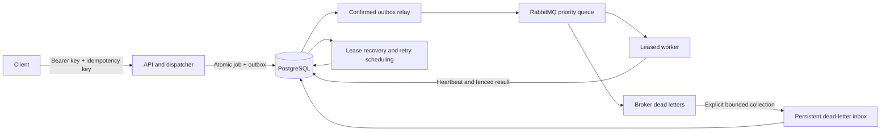

# Architecture and demonstration

## Explain the system

An authenticated REST API admits bounded text jobs into PostgreSQL with an outbox
entry in the same transaction. A dispatcher sends persistent, priority-aware
messages to RabbitMQ and removes the outbox entry only after publisher confirmation.
Workers claim a job in a short transaction, compute outside the database lock,
renew a lease and commit a result only while that attempt still owns the job.
API schedulers recover expired leases through new delivery generations. Automatic
retry backoff is stored in PostgreSQL; worker threads do not wait through backoff.

Delivery is at least once. Duplicate message delivery and stale result writes are
guarded, but a handler with external side effects must supply its own idempotency.
Owner-scoped API keys, shared submission admission, audited administration,
dead-letter recovery, structured logs and persistent lifecycle metrics complete
the application workflow. The included handlers compute word/character counts,
SHA-256 and uppercase text. There is no Redis dependency or hosted login service.

## Five-minute local demo

1. Follow [deployment](deployment.md), inspect `deploy.py status`, then check
   `/actuator/health/readiness` and an unauthenticated job request (401).
2. Run `scripts/smoke.py --base-url http://127.0.0.1:8088` with a privately loaded
   operator key. It schedules and cancels a job, manually retries it under a new
   linked ID, replays the retry key, and checks the result, attempts and event pages.
3. Run `scripts/auth-smoke.py` at the same base URL to demonstrate separate owners,
   scoped keys, quotas and revocation. It revokes temporary diagnostic keys afterward.
4. Show structured `job_transition` logs for a demo ID and its attempt; then show
   the [operations dashboard](observability.md) if the separate development
   monitoring profile is running. Its counters are committed lifecycle changes,
   not invented load figures.
5. Walk through a verified backup manifest and the release report. For a live
   failure demonstration use the **disposable** release/load harness, not a
   deployment containing someone else's jobs. The release drill restarts services,
   waits for active work on SIGTERM, restores empty volumes and repairs lost deliveries.

The complete drills take longer than the walkthrough. Pre-run them and open their
reports for a short demo. Keep archives, raw keys, private error logs and payloads
off-screen. No public URL or cloud credentials are required.

## Evidence-backed project description

Suggested concise technical description:

> Built a distributed job processing platform with Java 21, Spring Boot, PostgreSQL
> and RabbitMQ, including authenticated owner-scoped APIs, transactional outbox
> delivery, priority scheduling, leased worker execution, fenced completion,
> exponential-backoff retries and audited dead-letter recovery. Added Prometheus/
> Grafana observability, reproducible load/failure tests, and a single-host deployment
> with verified PostgreSQL backup/restore and recovery runbooks.

Optional measured statements, with scope retained:

- Verified 42,400 jobs across twelve recorded load runs, including four 10,000-job
  preloaded-queue drain comparisons; independently checked results and successful
  attempt counts. Best recorded preloaded drain was 445.49 jobs/sec.
- Improved median completion throughput 2.84× in repeated 300-job mixed scheduled
  pipeline tests through configuration tuning (34.50 to 97.81 jobs/sec).
- Accounted for 194/194 accepted jobs without observed loss across the recorded
  bounded resilience, priority and admission scenarios.
- Verified zero observed job loss in a separate [100-fault campaign](fault-campaign-results.md),
  with 800/800 accepted jobs correct and exactly one successful attempt per job;
  20 injections each of worker SIGKILL, worker pause/resume, broker crash, database crash and API crash.

Use whichever details fit the intended description. Tuning improvement is not
worker-count scaling. Four workers were slower for the measured short-text setup;
500+ jobs/sec end-to-end and 3.4× worker scaling are not supported. The recorded
100-fault campaign repeats five fault kinds on shared services; it is not 100
statistically independent environments. See [raw measurements](benchmark-results.md). The
single-host deployment, local restore drill and test suite do not establish an HA
service, a production SLA, an independent security audit or universal capacity.
